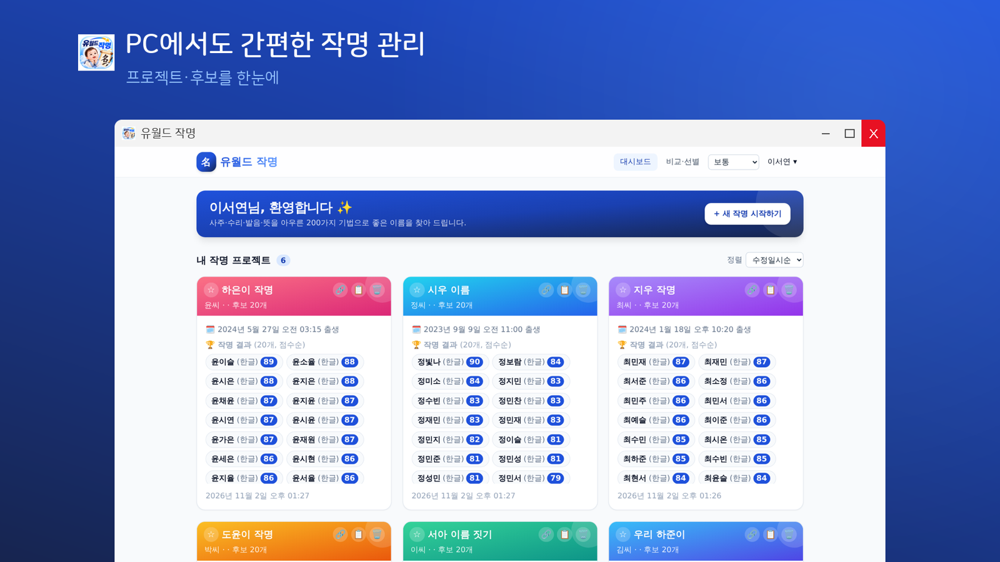
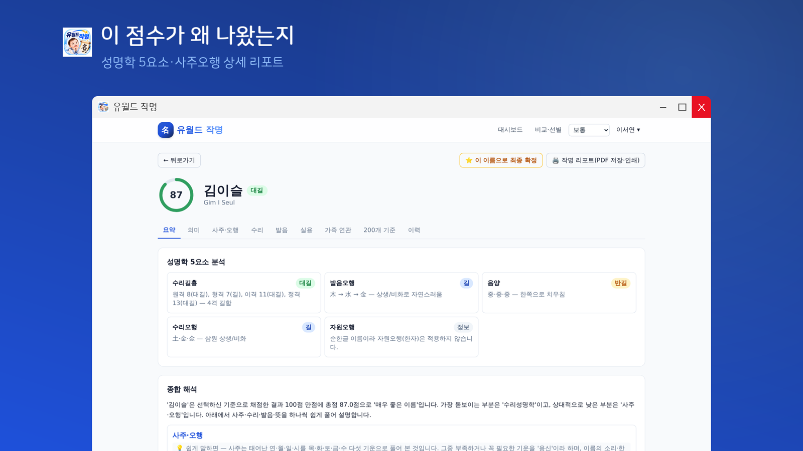
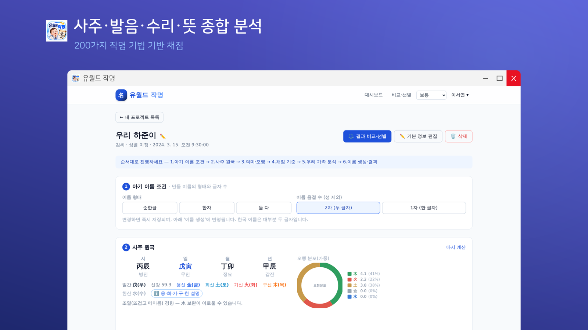
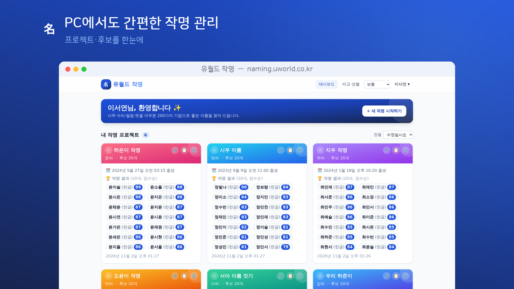

<div align="center">

# UWorld Naming · 유월드 작명

**Find a meaningful Korean name for your baby — Saju, sound, numerology and meaning, all in one place.**
**사주·발음·수리·뜻을 모두 담은 정성스러운 아기 이름 짓기.**

[](https://github.com/UWorld-Group/uworldnaming/releases/latest)
[](https://github.com/UWorld-Group/uworldnaming/releases)

| Windows | macOS | Android | Web |
|:---:|:---:|:---:|:---:|
| [**Download**](https://github.com/UWorld-Group/uworldnaming/releases/latest) | [**DMG**](https://github.com/UWorld-Group/uworldnaming/releases/latest) | [Google Play](https://play.google.com/store/apps/details?id=kr.co.uworld.naming) | [naming.uworld.co.kr](https://naming.uworld.co.kr) |

</div>

## Screenshots · 화면

<p align="center">
  
  
</p>
<p align="center">
  
  
</p>

---

## Why UWorld Naming · 왜 유월드 작명인가

Choosing a name is one of the first gifts parents give a child. In Korea, a good name is judged from many angles at once: the baby's **Saju** (the Four Pillars of birth date and time), how the name **sounds** with the family name, the stroke **numerology** of its Chinese characters, and above all its **meaning**. Weighing all of these by hand takes days of reference books and guesswork.

UWorld Naming does this work for you. It combines **200 traditional and modern naming methods** into one scoring system, generates Hangul and Hanja names that fit your baby's Saju, and explains every score in plain words — so you can understand *why* a name is good, not just *that* it is.

이름은 부모가 아이에게 주는 첫 선물입니다. 좋은 이름은 아기의 **사주**, 성과 어울리는 **발음**, 한자의 **수리(획수)**, 그리고 무엇보다 **뜻**을 함께 따져야 해서, 직접 하려면 여러 권의 책과 오랜 시간이 듭니다.

유월드 작명은 **200가지 작명 기법**을 하나의 채점 체계로 묶어, 아기 사주에 맞는 한글·한자 이름을 찾아 주고 점수 하나하나의 이유를 쉬운 말로 풀어 드립니다. "좋은 이름"이 아니라 "**왜** 좋은 이름인지"까지 알 수 있습니다.

## Features · 주요 기능

### 🔮 Saju analysis · 사주 분석과 해설
- Builds the baby's Four Pillars from the birth date and time (with true solar time correction) and explains the balance of the Five Elements, strength and the needed element (yongsin) in six easy paragraphs.
  생년월일시(진태양시 보정)로 사주를 세우고, 오행 분포·신강신약·용신을 여섯 단락의 쉬운 해설로 풀어 드립니다.

### ✨ Names scored by 200 methods · 200가지 기법 종합 채점
- Every candidate is scored on Saju fit, pronunciation and initial-sound harmony, stroke numerology and meaning, with a clear grade and a breakdown for each item.
  후보마다 사주 적합도·발음과 초성 조화·수리·뜻을 채점하고, 등급과 항목별 점수를 보여 줍니다.

### 🈶 Hangul and Hanja names · 한글 이름 · 한자 이름
- Suggests pure Korean names and Hanja names. Hanja are limited to the characters officially allowed for names by the Supreme Court of Korea, and characters with negative meanings are filtered out.
  순우리말 이름과 한자 이름을 함께 추천합니다. 한자는 대법원 인명용 한자만 쓰고, 부정적인 뜻의 글자는 걸러 냅니다.

### 📝 Rate the names you already like · 생각해 둔 이름 평가
- Type in the names you have in mind and see their full scores — and whether the app found something even better.
  부모님이 생각해 둔 이름을 넣으면 같은 기준으로 채점하고, 더 좋은 이름이 있는지도 비교해 드립니다.

### 👨‍👩‍👧 Harmony with the family · 가족과의 조화
- Considers the parents' and siblings' names: share a syllable, avoid names that sound too similar, or keep a generation character in a fixed position.
  부모·형제 이름과의 조화를 반영합니다. 음절 나누기, 너무 비슷한 발음 피하기, 돌림자 위치 고정도 할 수 있습니다.

### 📅 Birth date selection · 출산 택일
- For a planned delivery, compares candidate dates and times and recommends the best ones for the baby's Saju — even when the exact time is not decided yet.
  제왕절개 등 출산일을 정할 때 날짜·시간별로 사주를 비교해 좋은 때를 추천합니다. 시간이 정해지지 않았을 때는 날짜 단위로도 추천합니다.

### ⚖️ Compare, shortlist and save · 비교·선별과 보고서
- Put favourite names side by side, keep a shortlist, and save a detailed naming report as a PDF to print or share with family.
  마음에 드는 이름을 나란히 비교해 추려 두고, 자세한 작명 보고서를 PDF로 저장해 인쇄하거나 가족과 나눌 수 있습니다.

### 🔄 Same account everywhere · 어디서나 같은 계정
- Your projects are kept in your account, so you can start on a PC and continue on your phone or on the web.
  작명 프로젝트가 계정에 저장되어 PC에서 시작하고 휴대폰이나 웹에서 이어서 볼 수 있습니다.

---

## Install · 설치 안내

### Windows

**Requirements · 사양**: Windows 10 / 11 (64-bit), internet connection. The Microsoft Edge WebView2 runtime is installed automatically if it is missing.
Windows 10/11(64비트), 인터넷 연결. Microsoft Edge WebView2 런타임이 없으면 자동으로 설치됩니다.

1. Download **`UWorldNaming-<version>-windows-x64-setup.exe`** from the [latest release](https://github.com/UWorld-Group/uworldnaming/releases/latest).
   [최신 릴리스](https://github.com/UWorld-Group/uworldnaming/releases/latest)에서 설치 파일을 내려받습니다.
2. Run it and follow the installer. The installer and the app are code-signed by **유월드 (UWorld)**.
   실행하면 설치가 진행됩니다. 설치 파일과 프로그램은 "유월드" 이름으로 서명되어 있습니다.
3. *(Optional)* Verify the file with `SHA256SUMS.txt` from the same release:
   *(선택)* 같은 릴리스의 `SHA256SUMS.txt` 로 파일이 변조되지 않았는지 확인할 수 있습니다.
   ```powershell
   Get-FileHash .\UWorldNaming-<version>-windows-x64-setup.exe -Algorithm SHA256
   ```

### macOS (DMG)

**Requirements · 사양**: macOS 12 or later, Apple silicon or Intel, internet connection.
macOS 12 이상, Apple 실리콘·Intel, 인터넷 연결.

1. Download **`UWorldNaming-<version>-macos-universal.dmg`** from the [latest release](https://github.com/UWorld-Group/uworldnaming/releases/latest) and open it.
   최신 릴리스에서 DMG를 내려받아 엽니다.
2. Drag **유월드 작명** onto **Applications**. The app is signed with UWorld's Developer ID and **notarized by Apple**.
   **유월드 작명**을 응용 프로그램 폴더로 끌어다 놓습니다. 유월드 Developer ID 서명과 Apple 공증을 받은 앱입니다.
3. *(Optional)* Verify the file:
   *(선택)* 파일 확인:
   ```bash
   shasum -a 256 UWorldNaming-<version>-macos-universal.dmg
   ```

### Android · Web

- Android: [Google Play](https://play.google.com/store/apps/details?id=kr.co.uworld.naming)
- Web · 웹: https://naming.uworld.co.kr — works in any modern browser. 최신 브라우저에서 바로 사용할 수 있습니다.

---

## About this repository · 이 저장소에 대해

This repository is used **only to distribute installers**. The source code is not published here.
The "Source code" archives that GitHub attaches to every release contain only this README, the license and the screenshots.

이 저장소는 **설치 파일 배포 전용**입니다. 앱 소스코드는 공개하지 않으며, 릴리스마다 GitHub가 자동으로 붙이는 "Source code" 압축 파일에는 이 안내문·사용권 안내·화면 이미지만 들어 있습니다.

## Support · 문의

- Website · 웹사이트: https://service.uworld.co.kr

<div align="center">

Part of **[UWorld Group](https://github.com/UWorld-Group)** · See [LICENSE.txt](LICENSE.txt) · © UWorld. All rights reserved.

</div>
